<div align="center">

<p align="center">
  
</p>

# Local LLM

**A private, offline AI assistant running entirely on your mobile device.**

*Chat with cutting-edge open-weight LLMs, customize your experience, and stay in total control of your data — completely on-device. No subscriptions, no cloud tracking, and zero internet required.*

<br>


<br><br>

<p align="center">
<a href="https://github.com/smartworldarafath/Local-LLM/releases/tag/v1.2.0"><picture><source media="(prefers-color-scheme: dark)" srcset="assets/readme/dark/btn-download.svg">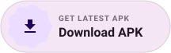</picture></a>
<a href="https://github.com/smartworldarafath/Local-LLM"><picture><source media="(prefers-color-scheme: dark)" srcset="assets/readme/dark/btn-github.svg"></picture></a>
<a href="#support"><picture><source media="(prefers-color-scheme: dark)" srcset="assets/readme/dark/btn-sponsor.svg"></picture></a>
<a href="#models"><picture><source media="(prefers-color-scheme: dark)" srcset="assets/readme/dark/btn-models.svg"></picture></a>
</p>

<p align="center">
<a href="#overview" title="100% Offline & On-Device Execution"><picture><source media="(prefers-color-scheme: dark)" srcset="assets/readme/dark/badge-offline.svg"></picture></a>
<a href="https://github.com/smartworldarafath/Local-LLM/releases/tag/v1.2.0" title="Latest Stable Release v1.2.0"><picture><source media="(prefers-color-scheme: dark)" srcset="assets/readme/dark/badge-version.svg"></picture></a>
<a href="#stack" title="Native Android & iOS Support"><picture><source media="(prefers-color-scheme: dark)" srcset="assets/readme/dark/badge-platform.svg"></picture></a>
<a href="https://github.com/ggerganov/llama.cpp" target="_blank" rel="noopener noreferrer" title="llama.cpp High-Performance C++ Inference"><picture><source media="(prefers-color-scheme: dark)" srcset="assets/readme/dark/badge-engine.svg"></picture></a>
<a href="#models" title="Qwen, Gemma, Llama, DeepSeek, Phi, SmolLM & Mistral"><picture><source media="(prefers-color-scheme: dark)" srcset="assets/readme/dark/badge-models.svg"></picture></a>
<a href="#hardware" title="GPU Layer Offloading via OpenCL & Metal"><picture><source media="(prefers-color-scheme: dark)" srcset="assets/readme/dark/badge-gpu.svg"></picture></a>
<a href="#overview" title="Zero Telemetry · Zero Cloud Routing"><picture><source media="(prefers-color-scheme: dark)" srcset="assets/readme/dark/badge-privacy.svg"></picture></a>
<a href="LICENSE" title="MIT License (100% Free & Open Source)"><picture><source media="(prefers-color-scheme: dark)" srcset="assets/readme/dark/badge-mit.svg"></picture></a>
<a href="https://github.com/smartworldarafath/Local-LLM/pulls" title="Pull Requests Welcome!"><picture><source media="(prefers-color-scheme: dark)" srcset="assets/readme/dark/badge-prs.svg"></picture></a>
</p>

</div>


---

<div align="center">

## 📸 Interface & Capabilities Preview

<table>
  <tr>
    <td align="center" width="25%" valign="top">
      <br><br>
      <b>💬 Private Chat</b><br>
      <sub>Stream tokens locally with zero cloud connection or telemetry.</sub>
    </td>
    <td align="center" width="25%" valign="top">
      <br><br>
      <b>📥 Model Hub</b><br>
      <sub>Qwen, Llama 3.2, DeepSeek, Gemma 2, Mistral, and Phi-3.5.</sub>
    </td>
    <td align="center" width="25%" valign="top">
      <br><br>
      <b>⚡ Hardware Benchmark</b><br>
      <sub>Granular CPU threads, GPU layers (OpenCL/Metal), and tokens/sec.</sub>
    </td>
    <td align="center" width="25%" valign="top">
      <br><br>
      <b>🎭 AI Personas (Pals)</b><br>
      <sub>Custom system prompts, roleplay personalities, and memory.</sub>
    </td>
  </tr>
</table>

</div>

---

<h3 id="overview"><picture><source media="(prefers-color-scheme: dark) and (max-width: 640px)" srcset="assets/readme/dark/hm-overview.svg"><source media="(prefers-color-scheme: dark)" srcset="assets/readme/dark/h-overview.svg"><source media="(max-width: 640px)" srcset="assets/readme/light/hm-overview.svg">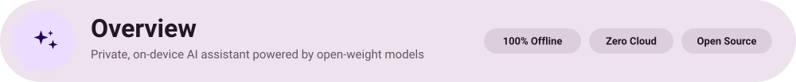</picture></h3>

**Local LLM** is a private, fully offline AI assistant engineered to run cutting-edge open-weight large language models directly on your smartphone (Android & iOS).

By fusing **llama.cpp**'s C++ quantization engine with native hardware backends (OpenCL for Qualcomm Adreno GPUs, Metal for Apple Silicon, and multi-core CPU threading), Local LLM lets you chat, analyze documents, and experiment with world-class LLMs anywhere — with **zero subscriptions, zero server dependencies, and zero telemetry**.

<table>
  <tr>
    <td width="50%" align="center">
      <picture>
        <source media="(prefers-color-scheme: dark)" srcset="assets/readme/dark/card-offline.svg">
        
      </picture>
    </td>
    <td width="50%" align="center">
      <picture>
        <source media="(prefers-color-scheme: dark)" srcset="assets/readme/dark/card-models.svg">
        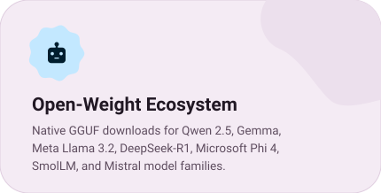
      </picture>
    </td>
  </tr>
  <tr>
    <td width="50%" align="center">
      <picture>
        <source media="(prefers-color-scheme: dark)" srcset="assets/readme/dark/card-hardware.svg">
        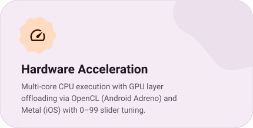
      </picture>
    </td>
    <td width="50%" align="center">
      <picture>
        <source media="(prefers-color-scheme: dark)" srcset="assets/readme/dark/card-theming.svg">
        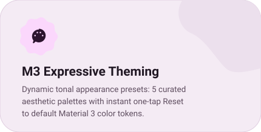
      </picture>
    </td>
  </tr>
  <tr>
    <td width="50%" align="center">
      <picture>
        <source media="(prefers-color-scheme: dark)" srcset="assets/readme/dark/card-benchmark.svg">
        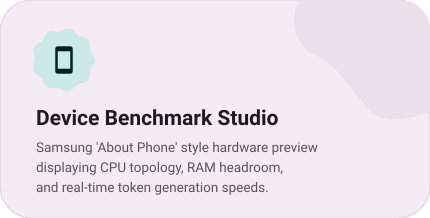
      </picture>
    </td>
    <td width="50%" align="center">
      <picture>
        <source media="(prefers-color-scheme: dark)" srcset="assets/readme/dark/card-profile.svg">
        
      </picture>
    </td>
  </tr>
</table>

<br>

<h3 id="features"><picture><source media="(prefers-color-scheme: dark) and (max-width: 640px)" srcset="assets/readme/dark/hm-features.svg"><source media="(prefers-color-scheme: dark)" srcset="assets/readme/dark/h-features.svg"><source media="(max-width: 640px)" srcset="assets/readme/light/hm-features.svg">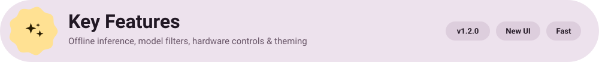</picture></h3>

- **🔒 100% Air-Gapped Privacy** — Every prompt, inference token, and message stays strictly on your physical device. No logs, no telemetry, no cloud relays.
- **🤖 Expanded Model Architecture Matrix** — Instant filters and fast multi-threaded downloads for **Qwen**, **Gemma**, **Meta Llama**, **DeepSeek**, **Microsoft Phi**, **SmolLM**, and **Mistral**.
- **⚡ Granular CPU & GPU Offloading** — Allocate dedicated CPU core threads and fine-tune GPU layer offload sliders (0–99) to optimize inference speed and battery endurance.
- **🎨 Dynamic Material 3 Expressive Appearance** — 5 curated aesthetic tonal color palettes (`#CDC5B4`, `#85756E`, `#95BB9E`, `#B8A5D6`, `#9397CC`) with a one-tap **Reset** button to restore defaults.
- **📱 Realistic Device Benchmark Mockup** — Samsung "About Phone" style hardware inspection overview displaying chipset topology, memory headroom, GPU driver status, and live generation speed.
- **👤 'My Profile' Management** — Profile picture personalization (preset avatars, upload, reset), name/email settings, dual storage strategy (**Sign-In** vs **Local Storage**), and chat history controls (**Local** vs **Don't Save**).
- **💬 Telegram Feedback Loop** — In-app feedback form integrated with the developer's Telegram bot for instant transmission of feature requests and suggestions.
- **🌐 In-App Multilingual Switching** — Dynamic language selector supporting full app localization with English as the default.

<br>

<h3 id="models"><picture><source media="(prefers-color-scheme: dark) and (max-width: 640px)" srcset="assets/readme/dark/hm-models.svg"><source media="(prefers-color-scheme: dark)" srcset="assets/readme/dark/h-models.svg"><source media="(max-width: 640px)" srcset="assets/readme/light/hm-models.svg">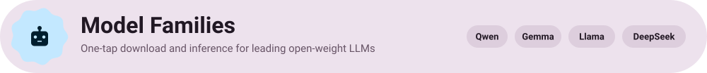</picture></h3>

Local LLM natively supports popular **GGUF-quantized** model architectures with automatic parameter detection, context window sizing, and prompt template resolution:

| Model Family | Developer | Architecture | Recommended Quants | Min. RAM | Target Use Case |
| :--- | :--- | :--- | :--- | :--- | :--- |
| **Qwen 2.5** | Alibaba Cloud / QwenLM | Dense Transformer | `Q4_K_M`, `Q5_K_M` | 4 GB – 8 GB | General reasoning, code synthesis, multi-turn chat |
| **Gemma 2 / 3 / 4** | Google DeepMind | Decoder-only Transformer | `Q4_K_M`, `Q4_0` | 4 GB – 6 GB | Creative writing, structured extraction, summarization |
| **Meta Llama 3.2** | Meta AI | Dense Transformer | `Q4_K_M`, `Q8_0` | 4 GB – 8 GB | Fast mobile assistant, low latency, daily task automation |
| **DeepSeek-R1 Distill** | DeepSeek AI | Reasoning Transformer | `Q4_K_M`, `Q5_K_M` | 6 GB – 12 GB | Step-by-step mathematical reasoning, deep problem solving |
| **Microsoft Phi 3.5 / 4** | Microsoft Research | Compact SLM | `Q4_K_M`, `Q4_K_S` | 4 GB – 6 GB | High-efficiency logical reasoning on resource-constrained devices |
| **SmolLM2** | Hugging Face TB | Ultra-compact SLM | `Q4_K_M`, `Q8_0` | 2 GB – 4 GB | Ultra-fast on-device inference, low memory devices, edge tasks |
| **Mistral NeMo & 7B** | Mistral AI | Dense Transformer | `Q4_K_M`, `Q5_K_M` | 6 GB – 12 GB | Multilingual comprehension, advanced instruction following |

<br>

<h3 id="hardware"><picture><source media="(prefers-color-scheme: dark) and (max-width: 640px)" srcset="assets/readme/dark/hm-hardware.svg"><source media="(prefers-color-scheme: dark)" srcset="assets/readme/dark/h-hardware.svg"><source media="(max-width: 640px)" srcset="assets/readme/light/hm-hardware.svg">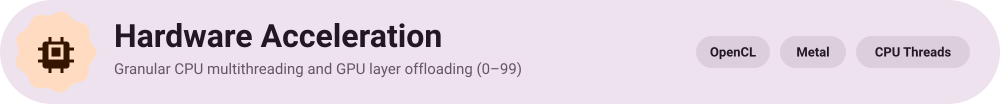</picture></h3>

Maximize token generation throughput and control thermals with hardware controls:

- **CPU Core Thread Tuning**: Allocate optimal compute threads (e.g., 4 to 8 threads) aligned with your device's big.LITTLE core cluster topology.
- **GPU Layer Offload Slider (0–99)**: Offload model compute layers directly to graphics hardware:
  - **Android**: Hardware-accelerated OpenCL compute pipelines targeting Qualcomm Adreno and ARM Mali GPUs.
  - **iOS**: Apple Metal compute pipelines with Unified Memory Architecture (UMA) for high tokens/sec.
- **Context Length & Cache Quantization**: Granular context sizing (512 to 32,768 tokens) with Flash Attention compatibility and FP16 / Q8 / Q4 KV-cache quantization.

<br>

<h3 id="appearance"><picture><source media="(prefers-color-scheme: dark) and (max-width: 640px)" srcset="assets/readme/dark/hm-appearance.svg"><source media="(prefers-color-scheme: dark)" srcset="assets/readme/dark/h-appearance.svg"><source media="(max-width: 640px)" srcset="assets/readme/light/hm-appearance.svg">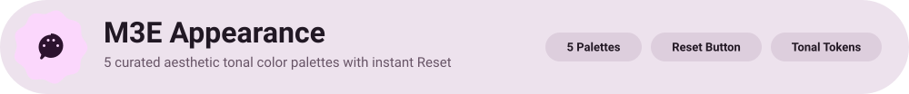</picture></h3>

Local LLM features a Material 3 Expressive dynamic themer with 5 curated tonal palettes designed for visual comfort:

| Palette Swatch | Hex Code | Aesthetic Style | Intended Atmosphere |
| :---: | :--- | :--- | :--- |
|  | `#CDC5B4` | **Warm Sand** | Minimalist editorial, warm neutral, soft daylight |
|  | `#85756E` | **Earth Mocha** | Grounded earthy tones, high contrast, warm reading mode |
|  | `#95BB9E` | **Sage Garden** | Calming organic green, reduced eye strain, nature-inspired |
|  | `#B8A5D6` | **Lavender Mist** | Creative lilac, playful expressive vibe, modern pastel |
|  | `#9397CC` | **Slate Blue** | Technical focus, clean oceanic tone, night shift balance |

> **Reset to Default**: A dedicated **Reset** button instantly clears custom tonal tokens and reverts to the default Material 3 color system with zero restart required.

<br>

<h3 id="benchmark"><picture><source media="(prefers-color-scheme: dark) and (max-width: 640px)" srcset="assets/readme/dark/hm-benchmark.svg"><source media="(prefers-color-scheme: dark)" srcset="assets/readme/dark/h-benchmark.svg"><source media="(max-width: 640px)" srcset="assets/readme/light/hm-benchmark.svg">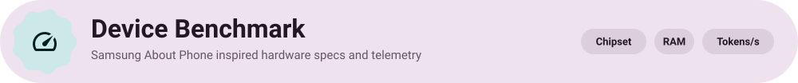</picture></h3>

The **Benchmark** section incorporates a hardware inspection view inspired by Samsung's "About Phone" design:

- **Chipset & Processor Topology**: Real-time identification of processor cores, clock speeds, and active threads.
- **RAM Headroom & Consumption**: Visualized bar graph displaying total physical RAM, active runtime footprint, and memory available for model loading.
- **Inference Speed Tracking**: Exact tokens-per-second (`t/s`) metrics for Prompt Evaluation (TTFT) and Token Generation across varied quantization depths.

<br>

<h3 id="profile"><picture><source media="(prefers-color-scheme: dark) and (max-width: 640px)" srcset="assets/readme/dark/hm-profile.svg"><source media="(prefers-color-scheme: dark)" srcset="assets/readme/dark/h-profile.svg"><source media="(max-width: 640px)" srcset="assets/readme/light/hm-profile.svg">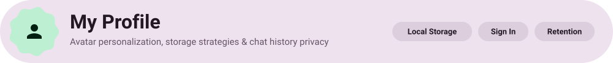</picture></h3>

The **My Profile** suite provides control over your user identity and data lifecycle:

- **Avatar Management**: Select from built-in avatar presets, upload custom profile pictures, or reset to default with smooth animated transitions.
- **Personal Details**: Manage your display name and optional email contact.
- **Dual Persistence Strategy**:
  - **Local Storage**: All settings, palettes, and configurations persist securely in device-encrypted offline storage.
  - **Sign-In**: Option to authenticate via streamlined email sign-in for cross-session continuity.
- **Chat History Control**:
  - **Local**: Conversations are stored locally using indexed on-device databases.
  - **Don't Save**: Ephemeral mode where chat sessions are flushed from memory immediately upon closing.
- **Direct Telegram Feedback**: Submit bug reports and feature requests directly to the developer's Telegram bot with zero telemetry metadata attached.

<br>

<h3 id="stack"><picture><source media="(prefers-color-scheme: dark) and (max-width: 640px)" srcset="assets/readme/dark/hm-stack.svg"><source media="(prefers-color-scheme: dark)" srcset="assets/readme/dark/h-stack.svg"><source media="(max-width: 640px)" srcset="assets/readme/light/hm-stack.svg">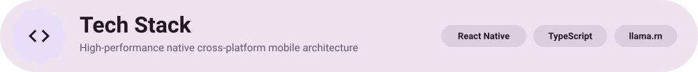</picture></h3>

<p align="center">
<picture><source media="(prefers-color-scheme: dark)" srcset="assets/readme/dark/pill-reactnative.svg"></picture>
<picture><source media="(prefers-color-scheme: dark)" srcset="assets/readme/dark/pill-typescript.svg"></picture>
<picture><source media="(prefers-color-scheme: dark)" srcset="assets/readme/dark/pill-llamacpp.svg"></picture>
<picture><source media="(prefers-color-scheme: dark)" srcset="assets/readme/dark/pill-android.svg"></picture>
<picture><source media="(prefers-color-scheme: dark)" srcset="assets/readme/dark/pill-metal.svg"></picture>
<picture><source media="(prefers-color-scheme: dark)" srcset="assets/readme/dark/pill-opencl.svg"></picture>
<picture><source media="(prefers-color-scheme: dark)" srcset="assets/readme/dark/pill-mobx.svg"></picture>
<picture><source media="(prefers-color-scheme: dark)" srcset="assets/readme/dark/pill-watermelondb.svg"></picture>
<picture><source media="(prefers-color-scheme: dark)" srcset="assets/readme/dark/pill-material3.svg"></picture>
</p>

| Component | Technology | Role & Purpose |
| :--- | :--- | :--- |
| **Framework** | [React Native](https://reactnative.dev/) (New Architecture) | Native UI rendering with TurboModules & Fabric C++ bindings |
| **Language** | [TypeScript](https://www.typescriptlang.org/) | Strict static typing across state stores, hooks, and native bridges |
| **Inference Core** | [llama.cpp](https://github.com/ggerganov/llama.cpp) via [`llama.rn`](https://github.com/mybigday/llama.rn) | Highly optimized C++ GGUF inference engine with low memory footprint |
| **Hardware Backends** | OpenCL & Apple Metal | Dedicated GPU layer offloading for Qualcomm Adreno, ARM Mali & Apple Silicon |
| **State Management** | [MobX](https://mobx.js.org/) + `mobx-persist-store` | Reactive state management with atomic observable properties |
| **Local Persistence** | [WatermelonDB](https://watermelondb.dev/) & AsyncStorage | Fast SQLite-backed offline document store for chats and model metadata |
| **Design System** | Google Material 3 Expressive (M3E) | Pixel-inspired dynamic palettes, scalloped geometry, and tactile tokens |

<br>

<h3 id="start"><picture><source media="(prefers-color-scheme: dark) and (max-width: 640px)" srcset="assets/readme/dark/hm-start.svg"><source media="(prefers-color-scheme: dark)" srcset="assets/readme/dark/h-start.svg"><source media="(max-width: 640px)" srcset="assets/readme/light/hm-start.svg">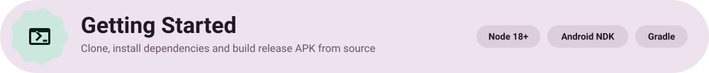</picture></h3>

### Prerequisites
- **Node.js**: v18.0.0 or higher
- **Package Manager**: Yarn (recommended)
- **Android Development**: Android Studio, Android SDK (API 34+), NDK (`27.3.13750724`), CMake (`3.22.1+`)
- **iOS Development**: macOS with Xcode 15+ and CocoaPods

### 1. Clone the Repository
```bash
git clone https://github.com/smartworldarafath/Local-LLM.git
cd Local-LLM
```

### 2. Install Dependencies
```bash
yarn install
```

### 3. Generate Local Pixel SVG Assets (Optional)
```bash
node scripts/generate-pixel-assets.js
node scripts/generate-preview-html.js
```

### 4. Run the Development Server
```bash
yarn start:reset
```

### 5. Build & Launch on Device

#### Android
```bash
# Debug Build
yarn android

# Release APK Build
cd android && ./gradlew assembleRelease
```
The compiled APK will be located at:
`android/app/build/outputs/apk/prod/release/app-prod-release.apk`

#### iOS
```bash
cd ios && pod install && cd ..
yarn ios
```

<br>

<h3 id="support"><picture><source media="(prefers-color-scheme: dark) and (max-width: 640px)" srcset="assets/readme/dark/hm-support.svg"><source media="(prefers-color-scheme: dark)" srcset="assets/readme/dark/h-support.svg"><source media="(max-width: 640px)" srcset="assets/readme/light/hm-support.svg">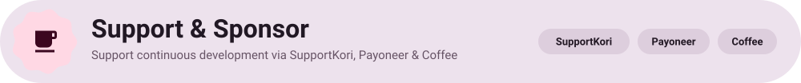</picture></h3>

Local LLM is 100% free, open-source, and developed independently. If you enjoy having private, offline AI on your phone and want to support ongoing development, consider sponsoring:

<div align="center">

| Platform | Support Link / Identifier | Accepted Payment Methods |
| :--- | :--- | :--- |
| **SupportKori** | [supportkori.com/arafathrahman](https://www.supportkori.com/arafathrahman) | bKash, Nagad, Rocket, Visa, Mastercard |
| **Buy Me a Coffee** | [buymeacoffee.com/arafathrahman](https://buymeacoffee.com/arafathrahman) | Cards, Apple Pay, Google Pay, PayPal |
| **GitHub Sponsors** | [github.com/sponsors/smartworldarafath](https://github.com/sponsors/smartworldarafath) | Monthly / One-time GitHub Sponsorship |
| **Payoneer** | Email: `arafathrahman710@gmail.com` | Direct Transfer · Customer ID: `70366820` |

</div>

<br>

<h3 id="license"><picture><source media="(prefers-color-scheme: dark) and (max-width: 640px)" srcset="assets/readme/dark/hm-license.svg"><source media="(prefers-color-scheme: dark)" srcset="assets/readme/dark/h-license.svg"><source media="(max-width: 640px)" srcset="assets/readme/light/hm-license.svg"></picture></h3>

Local LLM is licensed under the permissive **[MIT License](LICENSE)**.

<div align="center">

<a href="https://github.com/smartworldarafath">
  
</a>

#### **Arafath Rahman** ([@smartworldarafath](https://github.com/smartworldarafath))
*Creator, Lead Developer & Maintainer*

[](mailto:arafathrahman711@gmail.com)
[](https://github.com/smartworldarafath)
[](https://www.supportkori.com/arafathrahman)

</div>

<br>

<div align="center">
<sub>Local LLM • Your AI. Your Device. Your Privacy. • Built with Material 3 Expressive and llama.cpp</sub>
</div>
